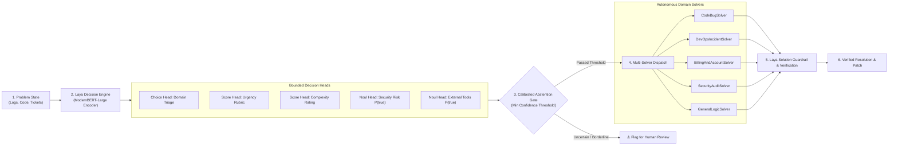

# ⚡ LayaResolve: Autonomous Problem Triage & Multi-Solver Engine

[](LICENSE)
[](https://python.org)
[](https://huggingface.co/convaiinnovations/laya)
[](https://github.com/junaidalishahgilgiti)
[](https://github.com/junaidalishahgilgiti/LayaResolve)

> **LayaResolve** is an open-source, high-speed problem triage, dynamic routing, and autonomous resolution engine powered by the **Laya AI decision model family** (`convaiinnovations/laya`) from Convai Innovations.

Developed and maintained by **[Junaid Ali Shah Gilgiti](https://github.com/junaidalishahgilgiti)**.

---

## 📖 Overview: How the AI & Application Work

Traditional generative Large Language Models (LLMs) generate output token-by-token. For structured decision making and problem routing, generative LLMs suffer from:
1. **High Latency & Token Costs**: Streaming 500 tokens of JSON takes 2–4 seconds and costs recurring API credits.
2. **Schema Drift & Hallucinations**: JSON parsing can fail unexpectedly due to missing braces, extra markdown commentary, or hallucinated enum labels.
3. **Uncalibrated Confidence**: LLMs often generate wrong answers with equal assertiveness, making automated safety gating difficult.

**LayaResolve solves this using a non-autoregressive decision pipeline:**



### The 3 Core Decision Primitives in Laya
* **`choice`**: Selects from a fixed set of named options based on explicit criteria (e.g. routing to `code_bug`, `devops_infra`, `billing_account`, `security_threat`, or `data_logic`).
* **`score`**: Rates an input along an ordered rubric (e.g. urgency: `routine` &rarr; `elevated` &rarr; `blocking`).
* **`noul`**: Evaluates the probability $P(\text{true})$ of a stated binary hypothesis (e.g. *"Does this introduce critical security risks?"* or *"Does the user threaten cancellation?"*).

---

## 🚀 Installation & Setup Guide

### System Requirements
* **Python**: Version `3.10` or newer
* **RAM**: 4 GB or higher (the model weights use ~800 MB in memory)
* **Compute**: Runs on standard CPU (Intel, AMD, Apple Silicon) or NVIDIA GPU (CUDA)
* **OS**: Linux, macOS, or Windows

---

### Method 1: Local Python Setup (Recommended)

#### Step 1: Clone the Repository
```bash
git clone https://github.com/junaidalishahgilgiti/LayaResolve.git
cd LayaResolve
```

#### Step 2: Create and Activate a Virtual Environment

**On Linux / macOS:**
```bash
python3 -m venv .venv
source .venv/bin/activate
```

**On Windows (PowerShell):**
```powershell
python -m venv .venv
.venv\Scripts\Activate.ps1
```

**On Windows (Command Prompt):**
```cmd
python -m venv .venv
.venv\Scripts\activate.bat
```

#### Step 3: Install Dependencies
```bash
pip install -r requirements.txt
```

#### Step 4: Run the Application
```bash
python run.py
```

Now open your web browser and go to:
👉 **`http://localhost:8000`**

---

### Method 2: Docker & Docker Compose (Zero Configuration)

If you have Docker and Docker Compose installed:

```bash
# 1. Clone repository
git clone https://github.com/junaidalishahgilgiti/LayaResolve.git
cd LayaResolve

# 2. Build and run in detached mode
docker compose up -d
```
Access the application at: **`http://localhost:8000`**

To stop the container:
```bash
docker compose down
```

---

## 💻 How to Use LayaResolve

### 1. Web Dashboard
* **Solver Studio**:
  * Select any benchmark problem from the **Preset Problem Scenarios** dropdown, or paste your own error logs / ticket.
  * Adjust the **Abstention Safety Threshold** (e.g., 60%). If Laya's certainty drops below this threshold, it automatically flags the problem for human review.
  * Click **Run Laya Triage Only** for sub-second classification across all 5 decision heads.
  * Click **Execute Full Solver Pipeline** to autonomously triage, route to the domain solver, and perform post-solution safety verification.
* **Decision Inspector**:
  * Experiment directly with Laya's raw `choice`, `score`, and `noul` heads by writing custom JSON states and questions.
* **Benchmark & Eval**:
  * Run batch evaluations across held-out datasets to measure domain accuracy, calibration reliability bins, and abstention rates.
* **Architecture & Docs**:
  * View system diagrams and implementation references.

---

### 2. Using the REST API

The FastAPI server exposes clean endpoints for programmatic integration:

#### A. Problem Triage Endpoint
```bash
curl -X POST http://127.0.0.1:8000/api/triage \
  -H "Content-Type: application/json" \
  -d '{
    "title": "ZeroDivisionError in telemetry aggregator",
    "description": "Analytics worker crashed with division by zero in calculate_average(items) when items list is empty.",
    "min_confidence": 0.60
  }'
```

**Example JSON Response:**
```json
{
  "domain": "code_bug",
  "domain_confidence": 0.676,
  "difficulty_label": "moderate",
  "urgency_label": "elevated",
  "is_sensitive": false,
  "needs_tools": false,
  "recommended_solver": "CodeBugSolver",
  "should_abstain": false,
  "latency_ms": 210.5
}
```

#### B. Full Resolution Pipeline
```bash
curl -X POST http://127.0.0.1:8000/api/solve \
  -H "Content-Type: application/json" \
  -d '{
    "title": "502 Bad Gateway during morning traffic spike",
    "description": "Gunicorn worker timeout (pid 4981) due to long DB queries under peak load.",
    "min_confidence": 0.60
  }'
```

#### C. Run Batch Evaluation
```bash
curl -X POST http://127.0.0.1:8000/api/eval
```

---

### 3. Using in Python Scripts Directly

You can import and use the Laya engine directly in your own Python projects:

```python
from backend.models import ProblemSubmission
from backend.engine import LayaDecisionEngine
from backend.solvers import registry

# 1. Initialize engine
engine = LayaDecisionEngine()

# 2. Define problem
problem = ProblemSubmission(
    title="KeyError in OAuth token exchange",
    description="Backend raised KeyError: 'refresh_token' when authenticating user.",
    min_confidence=0.60
)

# 3. Triage
triage = engine.triage_problem(problem)
print(f"Domain: {triage.domain} (Confidence: {triage.domain_confidence:.1%})")
print(f"Recommended Solver: {triage.recommended_solver}")

# 4. Solve
solver = registry.get_solver(triage.recommended_solver)
solution = solver.solve(problem, triage)
print("Solution:", solution.solution_summary)

# 5. Verify
verification = engine.verify_solution(problem, solution.code_or_patch)
print(f"Quality Score: {verification.verification_score}/100")
```

---

## 🧪 Running Automated Unit Tests

To run the automated test suite verifying engine initialization, triage accuracy, solver dispatch, and abstention gating:

```bash
python tests/test_engine.py
```

Expected output:
```text
Running LayaResolve verification tests...
[OK] Engine initialized
[OK] Triage test passed
[OK] Solver & verification passed
[OK] Abstention test passed
All tests passed successfully!
```

---

## 🧩 Adding Custom Solvers

You can add custom domain solvers in 5 lines of Python code in `backend/solvers.py`:

```python
from backend.solvers import BaseSolver, SolverExecutionResult, registry

class MyCustomSolver(BaseSolver):
    name = "MyCustomSolver"

    def solve(self, submission, triage) -> SolverExecutionResult:
        # Your custom logic, script execution, or API call
        return SolverExecutionResult(
            solver_name=self.name,
            solution_summary="Custom domain resolution completed.",
            detailed_steps=["Parsed input", "Executed action"],
            code_or_patch="# Auto-generated patch",
            execution_time_ms=15.0
        )

# Register with registry
registry.solvers["MyCustomSolver"] = MyCustomSolver()
```

---

## 👤 Author & Contributor

* **Author**: **Junaid Ali Shah Gilgiti**
* **GitHub**: [@junaidalishahgilgiti](https://github.com/junaidalishahgilgiti)
* **Repository**: [https://github.com/junaidalishahgilgiti/LayaResolve](https://github.com/junaidalishahgilgiti/LayaResolve)

Contributions, feature requests, and feedback are welcome! Feel free to open an issue or pull request on GitHub.

---

## 📜 License & Acknowledgments

* **License**: Distributed under the **Apache 2.0 License**. See [LICENSE](LICENSE) for details.
* **Model**: Powered by the **Laya AI Model** (`convaiinnovations/laya`) by Convai Innovations.
