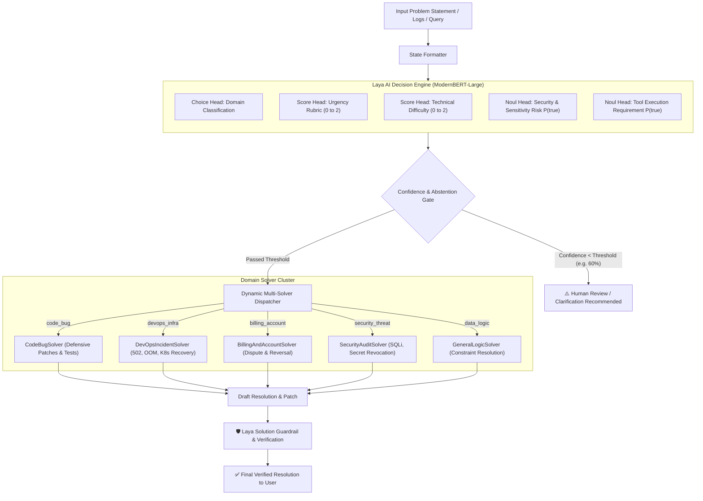

# ⚡ LayaResolve: Autonomous Problem Triage & Multi-Solver Engine

[](LICENSE)
[](https://python.org)
[](https://huggingface.co/convaiinnovations/laya)
[](#architecture)

> **LayaResolve** is an open-source, high-speed problem triage, dynamic routing, and autonomous resolution engine powered by the **Laya AI decision model family** (`convaiinnovations/laya`).

Unlike traditional generative LLMs that waste seconds streaming token-by-token JSON (risking schema drift, hallucinations, and high cloud API bills), LayaResolve leverages **non-autoregressive bidirectional encoder decision heads** to triage incoming issues in milliseconds, score urgency/complexity, enforce safety abstention thresholds, and dispatch problems to specialized autonomous solvers.

---

## 🏛️ System Architecture



---

## ✨ Key Features

* **Sub-Second Local CPU Inference**: Powered by ModernBERT-large (~421M parameters). Runs completely offline on standard laptops/servers without dedicated GPU requirements.
* **Three Typed Decision Primitives**:
  * **`choice`**: Discrete category selection with strict operational definitions (Code, DevOps, Billing, Security, Logic).
  * **`score`**: Ordered rubric rating for urgency (`routine` $\rightarrow$ `elevated` $\rightarrow$ `blocking`) and difficulty.
  * **`noul`**: Direct calibrated probability estimation $P(\text{true})$ for binary safety/risk propositions.
* **Calibrated Selective Abstention**: Automatically flags borderline or ambiguous problems for human review instead of making confident wrong guesses.
* **Autonomous Multi-Domain Solvers**: Built-in resolution engines for code bugs, infrastructure failures, billing audits, and security vulnerability remediations.
* **Secondary Solution Verification**: Uses Laya to evaluate generated solutions against the original constraints to ensure safety and completeness before dispatch.
* **Stunning Web Dashboard**: Cybernetic dark-mode UI with live animated probability distributions, interactive model playground, and batch evaluation suite.

---

## 🚀 Quickstart

### Prerequisites
* Python 3.10 or newer (tested on Python 3.11, 3.12, 3.13, 3.14)
* 4GB+ RAM (model uses ~800MB in memory)

### 1. Clone & Install
```bash
git clone https://github.com/your-org/LayaResolve.git
cd LayaResolve

# Create virtual environment
python -m venv .venv
source .venv/bin/activate  # On Windows: .venv\Scripts\activate

# Install dependencies
pip install -r requirements.txt
```

### 2. Run the Application
```bash
python run.py
```
Open your browser and navigate to:
👉 **`http://localhost:8000`**

---

## 🐳 Docker Deployment

Run with one command via Docker Compose:
```bash
docker compose up -d
```
The Docker image caches Hugging Face weights in a persistent Docker volume, so weights are only downloaded once.

---

## 🔌 REST API Documentation

### 1. Triage an Issue
```bash
POST /api/triage
Content-Type: application/json

{
  "title": "ZeroDivisionError in telemetry aggregator",
  "description": "Worker crashed with division by zero in calculate_average(items) when array is empty.",
  "min_confidence": 0.60
}
```

**Response:**
```json
{
  "domain": "code_bug",
  "domain_confidence": 0.974,
  "difficulty_label": "moderate",
  "urgency_label": "elevated",
  "is_sensitive": false,
  "needs_tools": false,
  "recommended_solver": "CodeBugSolver",
  "should_abstain": false,
  "latency_ms": 215.4
}
```

### 2. Execute Full Solve Pipeline
```bash
POST /api/solve
Content-Type: application/json

{
  "title": "502 Bad Gateway during morning traffic spike",
  "description": "Gunicorn worker timeout (pid 4981) due to long DB queries under peak load.",
  "min_confidence": 0.60
}
```

### 3. Run Benchmark Evaluation Suite
```bash
POST /api/eval
```
Computes domain classification accuracy, average calibrated confidence, selective abstention rate, and reliability bins over the test dataset.

---

## 🧩 Adding a Custom Solver

Adding a specialized solver takes 5 lines of code in `backend/solvers.py`:

```python
from backend.solvers import BaseSolver, SolverExecutionResult, registry

class MyCustomSolver(BaseSolver):
    name = "MyCustomSolver"

    def solve(self, submission, triage) -> SolverExecutionResult:
        # Your custom logic, external API call, or script execution
        return SolverExecutionResult(
            solver_name=self.name,
            solution_summary="Custom resolution executed.",
            detailed_steps=["Step 1...", "Step 2..."],
            code_or_patch="echo 'resolved'",
            execution_time_ms=12.0
        )

# Register with registry
registry.solvers["MyCustomSolver"] = MyCustomSolver()
```

---

## 📜 License

Distributed under the **Apache 2.0 License**. See [LICENSE](LICENSE) for details.

Developed with the [Laya AI Model](https://huggingface.co/convaiinnovations/laya) by Convai Innovations.
